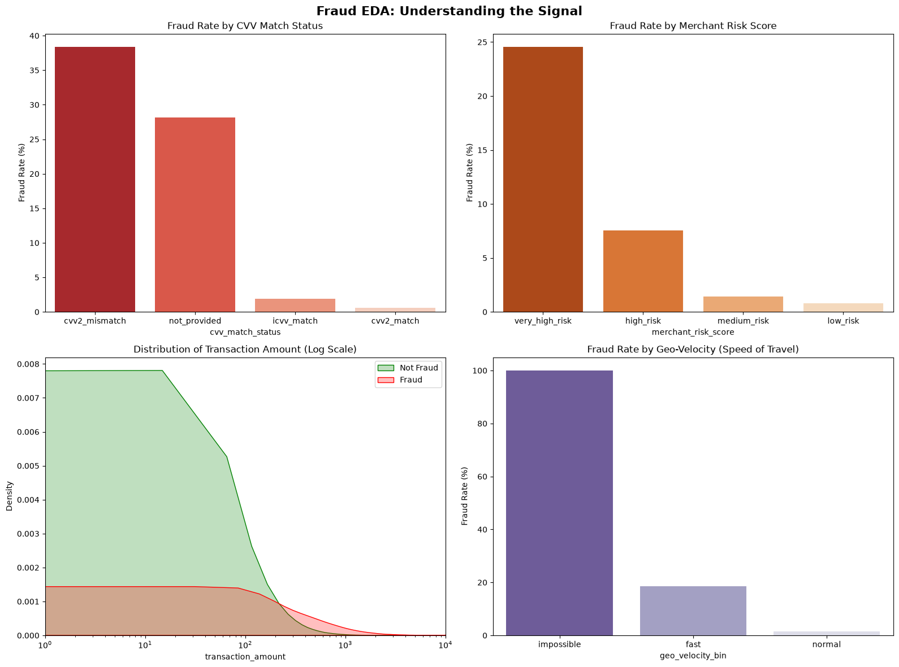
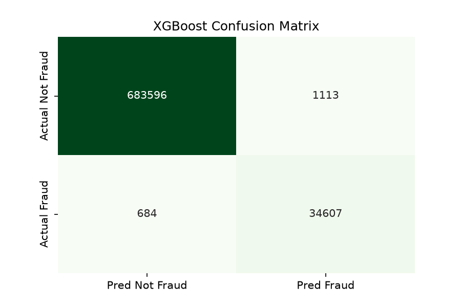
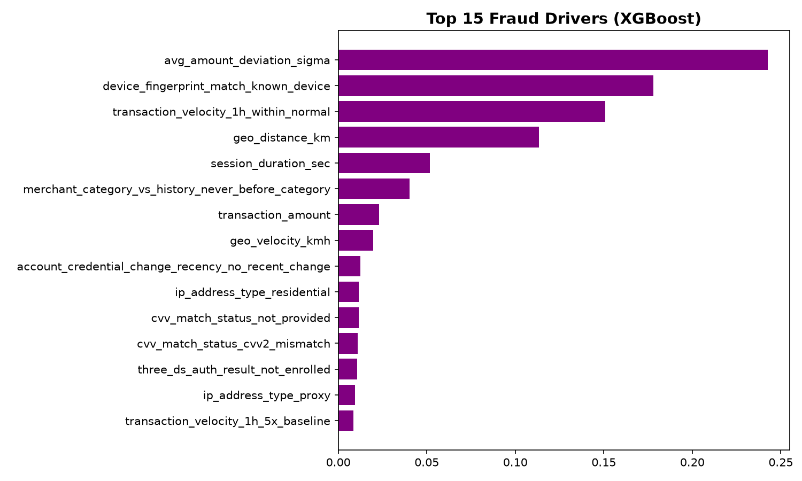
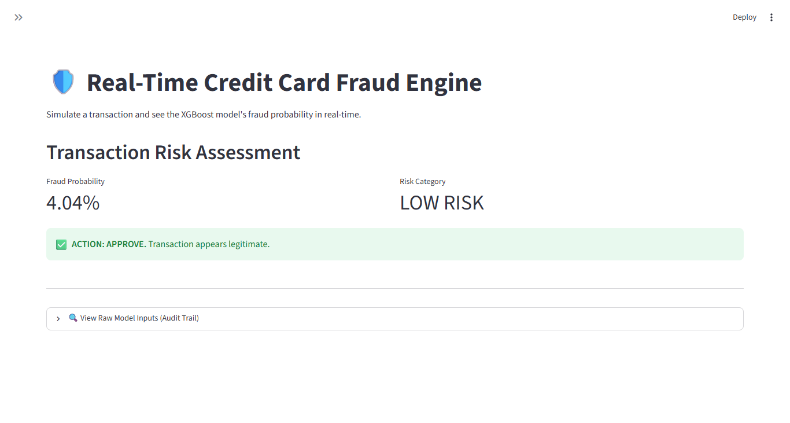
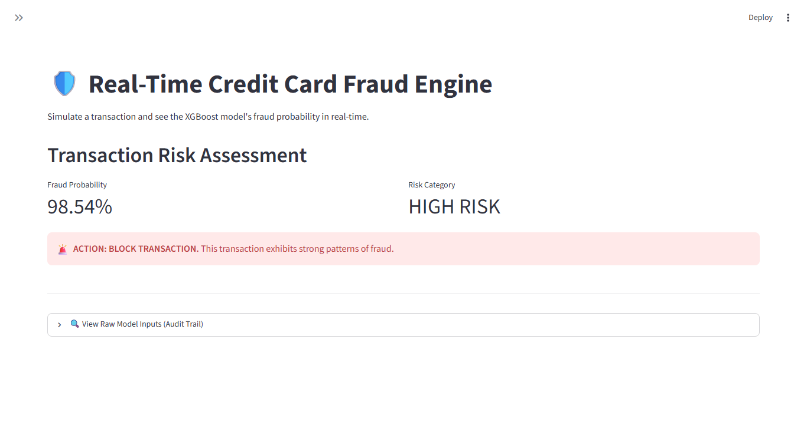

# Credit_Card_Fraud_Detection
Big Data credit card fraud detection using PyArrow, Champion/Challenger (Logistic vs XGBoost), and Streamlit.

# Credit Card Fraud Detection (XGBoost)

## Overview
This repository contains a machine learning pipeline for detecting credit card fraud on a dataset of 2.4 million transactions. It demonstrates handling of extreme class imbalance, chunked big-data processing (via PyArrow), and a Champion/Challenger modeling approach.

## Key Features
*   **Big Data Processing:** Utilized PyArrow to read a 15-million-row Parquet file in chunks, extracting a time-representative sample of 2.4 million rows without crashing local RAM.
*   **Business EDA:** Visualized fraud rates across CVV match status, merchant risk, transaction amounts, and geo-velocity (impossible travel).
*   **Multivariate Screening:** Generated a Correlation Matrix and systematically dropped 13 collinear and potential leakage features (e.g., `cards_on_device_30d` which had a 0.75 correlation with the target).
*   **Champion Model (Logistic Regression):** Achieved a 98% Recall and 90% Precision using `class_weight='balanced'`.
*   **Challenger Model (XGBoost):** Achieved a 98% Recall and **97% Precision**, reducing False Positives from 3,697 to just 1,113.

## Model Validation & Insights

*Figure 1: Exploratory Data Analysis. Shows the massive predictive power of CVV mismatches and impossible Geo-Velocity.*

*Figure 2: XGBoost Confusion Matrix. The model catches 98% of all fraud while maintaining a 97% precision rate.*

*Figure 3: Top Fraud Drivers. Behavioral anomalies (Amount Deviation) and Device Intelligence are stronger predictors than raw transaction amount.*

## Interactive Dashboard
The Streamlit app allows users to simulate a transaction and receive a real-time fraud probability and risk action. It includes an Audit Trail to show exactly what data is being passed to the model.

**Low Risk Scenario (Normal Customer)**

**High Risk Scenario (Impossible Travel + Unknown Device + CVV Mismatch)**

---
**Author:** Raymond Sibanda | [LinkedIn](https://www.linkedin.com/in/raymond-sibanda)
FRM | BSc Mathematics | BCom Honors Accounting
